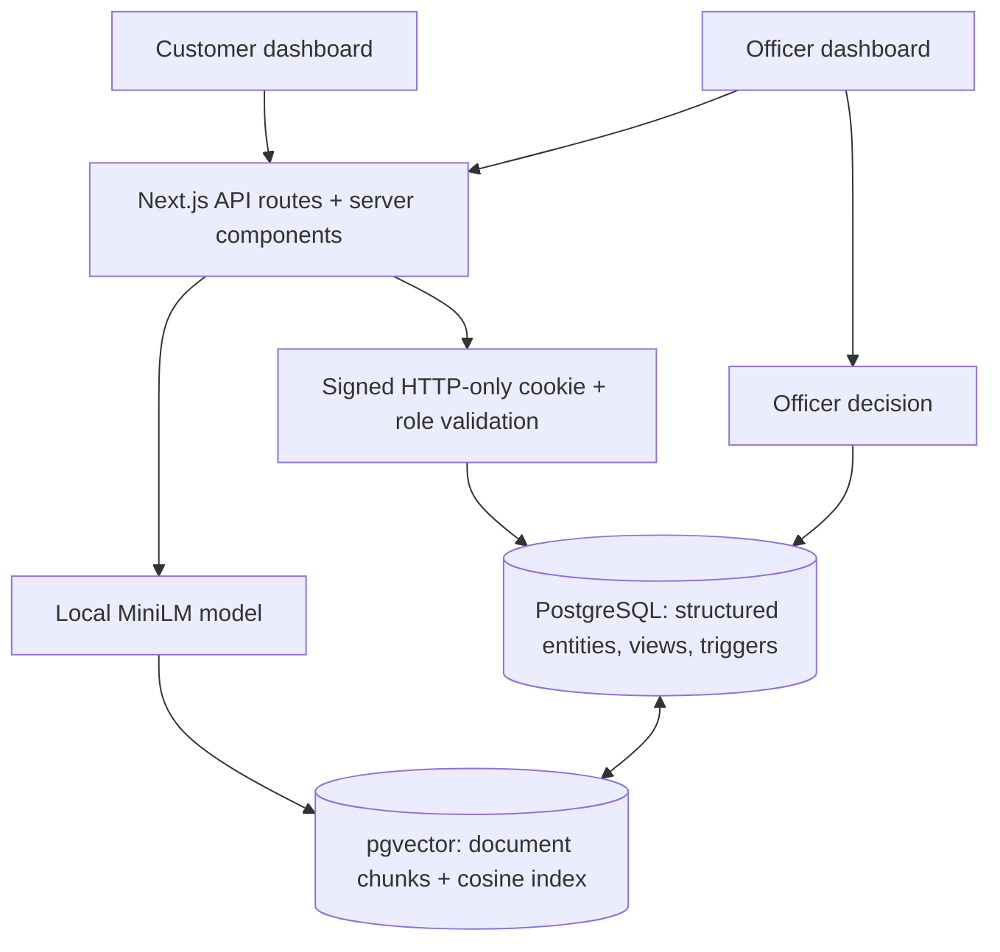

# CLAIMLENS
## DBMS Experiential Learning — Level 3 Project Report

**Project title:** CLAIMLENS — Warranty Claims and Semantic Policy Retrieval  
**Academic context:** DBMS Experiential Learning, Level 3  
**Team:** Two members (enter actual names/roll numbers before submission)  
**Implementation status:** Locally audited on 22 October 2026. Unit/setup 11/11, added DB checks 38/38, production HTTP checks 78/78, six clean-schema migrations, original smoke suite and production build passed. See [AUDIT_RESULTS.md](AUDIT_RESULTS.md) for evidence and limits. This Markdown report is current; the original PDF is a historical pre-audit snapshot.

---

## 1. Abstract

Warranty claim portals often record complaints and their final outcomes without providing a structured way to trace a decision back to the applicable policy wording. CLAIMLENS integrates customers, product registration, warranty entitlements, claims, evidence, officer assignments, decisions and repair orders in a PostgreSQL relational database. For lengthy policy documents, a pgvector knowledge layer stores normalized 384-dimensional sentence embeddings from overlapping text chunks. When an officer examines a claim, the application retrieves passages relevant to the reported fault from that product's specific policy. A human officer remains responsible for the decision. Advanced DBMS concepts include referential and domain constraints, stored procedures/functions, transaction-safe changes, triggers, views, query indexes and vector similarity search.

## 2. Problem statement and motivation

Being within the warranty date range is not equivalent to being covered for a particular defect. Terms can distinguish a manufacturing flaw from misuse or accidental damage, and are often buried in unstructured policy documents. Customers require visible claim tracking, while staff require linked product records, a trustworthy claim history and fast access to the relevant policy language. The system addresses operational traceability and decision support rather than claiming to automatically settle legal disputes.

## 3. Objectives

1. Maintain structured customer, manufacturer, product, registration, warranty, claim and repair data.
2. Associate each purchased product with the correct manufacturer-specific, versioned warranty policy.
3. Validate ownership, serial numbers, dates and officer responsibilities through database controls.
4. Support customer claim submission with issue descriptions and optional supporting evidence links.
5. Let officers assign, retrieve policy passages, document decisions and process approved repairs.
6. Index unstructured policy passages with a vector database for semantic retrieval.
7. Demonstrate at least four advanced SQL concepts and at least one vector-database concept.
8. Provide a working Next.js interface, reproducible setup, tests and version-controlled source.

## 4. Functional requirements

**Customer:** self-register and authenticate; list warranties and statuses; register eligible product models; submit a claim with optional evidence URL; view own claim, decision, evidence and limited search results.

**Claim officer:** authenticate with provisioned officer credentials; view/search/filter claim queue; assign an unassigned case; inspect its registered product and warranty; run policy-scoped vector retrieval; review evidence and retrieved text; record an approval/rejection with a nonempty reason; advance approved repair states; ingest and inspect policy documents and structured rules.

**System:** preserve relational constraints, enforce claim ownership, forbid assignment to non-officers, create approved repair orders through a trigger, log key operations, preserve policy document metadata and keep sensitive configuration out of version control.

## 5. Technology and database justification

| Layer | Technology | Purpose |
| --- | --- | --- |
| Web interface | Next.js 15, React 19, TypeScript | Server-rendered dashboards and accessible forms |
| Backend | Next.js Node.js API route handlers | Authentication, validation, transactional writes |
| Primary database | PostgreSQL 17 | Structured ACID transactions, schema and referential integrity |
| Vector extension | pgvector | 384-dimensional embeddings and cosine similarity search |
| Embedding generation | Transformers.js + `onnx-community/all-MiniLM-L6-v2-ONNX` | Local natural-language embedding generation |
| Validation | Zod + PostgreSQL CHECK/FK/UNIQUE | Application and database integrity |
| Development infrastructure | Docker Compose, npm, Git/GitHub | Reproducibility and collaborative development |

This project uses the guidelines' **Option 2: SQL + vector database**. The vector component is not arbitrary; unstructured warranty terms require meaning-oriented retrieval, and storing vector embeddings in PostgreSQL simplifies joins to the actual policy associated with the purchased product. MongoDB is not required.

## 6. System architecture

Client requests are validated at the API boundary. SQL commands use parameters and operate through a constrained backend. The same relational database stores document-to-policy ownership and vector search metadata. Officer decisions execute a database trigger that atomically updates the claim, creates repair orders for approvals and writes an audit event.

## 7. Entity-relationship model and relational schema

The ER diagram represents **16 tables**. Major relationships: customer 1:N registered products, manufacturer 1:N models/policies, registered product 1:0..1 warranty, warranty 1:N claims, claim 1:0..1 officer assignment/final decision/repair order, policy 1:N documents, document 1:N chunks, and claim N:M chunks through ranked semantic matches. Policy rules are separate from unstructured document paragraphs so both structured conditions and free-text language can be reviewed. See `DATA_DICTIONARY.md` for the full entity attributes, keys, constraints and cardinalities and `db/migrations/001_init.sql` for executable schema details.

## 8. Relational design: advanced database concepts

### 8.1 Primary/foreign keys and integrity

Users, products, models, manufacturers, policies, warranties and claims have UUID primary keys and referential foreign keys. Serial numbers and decision-per-claim relationships are unique. CHECK constraints verify role/status enums, claim-description length, warranty date order and vector result bounds. Triggers reject manufacturer-policy mismatch and claims submitted by a nonowner.

### 8.2 Stored functions and triggers

- `register_warranty(...)` atomically inserts a registered product and its warranty period, validating eligible customer and policy.
- `validate_warranty` rejects policies not issued by the registered model's manufacturer.
- `validate_claim_ownership` rejects a claim whose customer does not own the associated product. `enforce_claim_state_transition` prevents an unassigned or undecided claim from being marked under review or finally resolved through direct SQL updates, and protects the submitted claim facts. Migration 004 evaluates warranty eligibility at the **claim submission date** (not today), treats end dates as inclusive and makes historical officer assignments immutable. `validate_semantic_match_scope` rejects retrieved passages from a policy unrelated to the claim, even when inserted via direct SQL.
- `validate_officer_assignment` permits only active officer accounts.
- `apply_claim_decision` enforces assigned officer and in-review state, changes verdict, creates an approved repair order and audits the action.
- `check_repair_transition` rejects invalid repair-state changes.
- Submission and repair transition triggers record audit events. Migration 003 prevents silent UPDATE/DELETE of final decisions and audit events.

### 8.3 ACID transactions

Claim and supporting evidence are inserted within one backend transaction. Ingested policy documents and all their chunks are inserted within another transaction after embeddings are prepared. The stored warranty registration function runs as one database call. Failed steps roll back; the transactional database test deliberately rolls back all its artificial records.

### 8.4 Views, indexes and query optimization

`v_claim_overview` joins customer, registered product, manufacturer, warranty, assignment and decision fields. `v_policy_inventory` summarizes policy document and chunk counts. `v_claim_status_summary` aggregates claim counts by status. Indexes include compound claim status/time and customer/time indexes; a functional lowercased-email index; a GIN index on chunk JSONB metadata; and pgvector HNSW index for cosine nearest-neighbor search.

### 8.5 SQL queries and DML

`db/queries_for_viva.sql` supplies reproducible SELECT, JOIN, GROUP BY, HAVING, ORDER BY, aggregates, correlated subqueries, JSONB filters and a safe transactional CREATE/ALTER/DROP + INSERT/UPDATE/DELETE exercise. The Next.js routes perform actual product registration, claim insertion, evidence insertion, claim status changes, officer decision creation and repair-state updates.

## 9. Semantic retrieval data model and procedure

**Document representation:** each policy document stores original text, SHA-256 checksum, creator, title and policy FK. `chunkPolicy` splits the text into overlapping windows of 115 words (25-word overlap). Every passage is embedded with MiniLM to produce a 384-dimensional normalized float vector. The chunk row stores text, position, `vector(384)` and JSONB metadata identifying the model/document title.

**Query:** claim issue text is embedded using the same model. The database first links chunk rows to the actual warranty policy's document rows and orders matches by cosine distance (`embedding <=> :query_vector`). The top five are persisted in `semantic_matches` with rank, bounded similarity and retrieval date. Only the officer interprets coverage, exclusions and evidence. Coverage eligibility uses the claim submission date so the result does not change merely because a past warranty expires during a lengthy review.

**Important qualification:** similarity is a ranking mechanism, not confidence that a claim should be approved. Claims with short vague descriptions, irrelevant policy documents or highly overlapping chunks may produce weak retrieval. The implementation does not validate the legal accuracy of fictional demo policies.

## 10. Authentication, authorization and validation

There are two roles: `customer` and `officer`. Public registration provisions customers only; demo officers are provisioned via the seed script. User passwords are salted with `scrypt`. User ID and expiry are signed using an HMAC-SHA256 session token held in a secure-in-production HTTP-only cookie. The backend re-reads user role and active status on each request. Customer-facing claim details check ownership, and officer mutation routes require an officer role. Zod validates incoming request types; PostgreSQL provides a second layer of constraints. Secrets are supplied by `.env`. Same-origin mutation checks are implemented. Rate limiting, persistent session revocation, monitoring, retention and deployment hardening remain outside the verified classroom scope.

## 11. Main workflows

**Register:** customer account -> manufacturer/model selection -> policy selection -> serial/purchase date -> `register_warranty` -> product and warranty records.

**Submit:** customer chooses their warranty -> describes issue -> optionally references evidence -> transactional claim submission -> submission audit log.

**Review:** officer assigns claim -> retrieves top-ranked policy passages -> views exclusions/coverage and evidence -> records reasoned verdict -> database trigger updates claim, logs decision and creates repair order if approved.

**Repair:** assigned officer moves a newly approved repair from `open` to `in_progress`, then `completed` or `cancelled`; DB checks transitions and audits changes.

## 12. Executed testing evidence

| Area | Observed result |
| --- | --- |
| Passwords, sessions, chunks, vectors, validation, dates, setup/doctor | 11/11 unit/setup tests passed |
| Original ownership, lifecycle, immutable history, policy scope and temporal smoke suite | Passed against local PostgreSQL; test writes rolled back |
| Added integrity/role/date/reference guards | 38/38 assertions passed; writes rolled back |
| Clean installation | Six migrations passed in temporary schema; 16 tables, vector(384), HNSW/GIN; schema rolled back |
| HTTP and authorization | 73/73 development and 78/78 expanded production checks passed |
| Browser | Populated registration, products, claims, assignment, retrieval, approval, rejection, repair completion and policy ingestion verified |
| Real semantic search | Normalized 384-dimensional inference, policy isolation and compatibility with existing stored vectors passed |
| SQL and live integrity | Ten invariants have zero violations; viva queries and query plans executed |
| Build and dependencies | TypeScript/production build passed; npm audit zero vulnerabilities |
| Preservation | 32 original rows retained; one explicitly approved expiry correction audited; every other original field and environment value unchanged |

See [audit results](AUDIT_RESULTS.md), [verification](VERIFICATION.md), [requirements matrix](REQUIREMENTS_AUDIT.md), and [separate change tracker](../CHANGELOG_AUDIT.md). No second distinct officer browser session, load/soak/fuzz run, exhaustive browser/accessibility matrix, restore drill or external deployment is claimed. Cancellation passed API/DB tests rather than a separate browser submission. Semantic examples were sampled rather than benchmarked. CI publication and genuine team attribution require human action.

## 13. Real application screenshots

Captured from the running local app:

1. [Populated customer claim](audit-evidence/customer-claim-form.png).
2. [Production customer outcomes](audit-evidence/customer-production.png).
3. [Filtered officer queue](audit-evidence/officer-filter.png).
4. [Actual semantic review](audit-evidence/semantic-review.png).
5. [Completed repair and audit history](audit-evidence/completed-repair.png).
6. [Policy indexing success](audit-evidence/policy-indexed.png).
7. [Production rejection](audit-evidence/rejected-production.png).
8. [Policy effective-date validation](audit-evidence/policy-date-blocked.png).

## 14. Scope, limitations, and future work

The executed local database, browser, HTTP and production checks passed. Exact test limits remain in AUDIT_RESULTS.md; no exhaustive correctness or production deployment guarantee is claimed. The scope deliberately targets classroom demonstration: evidence is represented as a link, policies are ingested as pasted text rather than PDF uploads, no automatic legally binding coverage decision is issued, and a public officer-management interface is not included. Useful future work includes file-storage upload, versioned source-document highlighting, configurable policy versions, retrieval quality evaluation and authenticated admin provisioning.

## 15. Conclusion

CLAIMLENS is designed to demonstrate why advanced database features matter in a real operational workflow. PostgreSQL protects transaction consistency, ownership and traceability, while pgvector connects unstructured policy content to claim records. The design exceeds simple CRUD through stateful decisions, automatic database actions, auditable repairs and semantic retrieval, while preserving human responsibility for coverage decisions. End-to-end claims of success must follow actual installation and test evidence.

## 16. Repository and team attribution

**Public GitHub repository URL:** _add after the two-person team creates and pushes its public repository_.  
**Member 1:** _enter real student name, registration number and work backed by their Git commits_.  
**Member 2:** _enter real student name, registration number and work backed by their Git commits_.

Follow `docs/CONTRIBUTIONS.md` to ensure each person has demonstrable contributions to both the database and application, as required by the guidelines.
